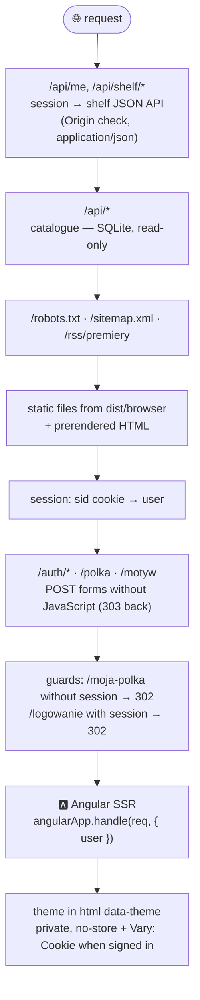

<div align="center">


# 🐉 Łuska i Ciernie 🌹

**Scale and Thorns — a romantasy archive read by trope**
<br />
*from fated bonds to dragon riders*

<br />


<br />


<br />


<br />
<br />

📚 **91 books** &nbsp;·&nbsp; ✒️ **38 authors** &nbsp;·&nbsp; 🔮 **17 tropes** &nbsp;·&nbsp; 🗺️ **17 stages**

[✨ Features](#-features) &nbsp;·&nbsp; [🚀 Quick start](#-quick-start) &nbsp;·&nbsp; [🏰 Architecture](#-architecture) &nbsp;·&nbsp; [🚢 Deployment](#-deployment) &nbsp;·&nbsp; [🧭 Stage history](#-stage-history)

</div>

---

Łuska i Ciernie is a catalogue and search engine for romantasy books. Readers of the genre search
differently than in an ordinary bookshop: by **trope** ("enemies to lovers", "fated mates",
"fae courts"), by **spice level** 🌶️ and by **whether the series is finished yet**. The site is
built around exactly those questions.

> [!NOTE]
> This is an **educational project**: the app was built in stages (one commit per stage) to
> practise the whole range of **Angular SSR** — server rendering, prerendering, hydration and
> transfer state, through SEO, server-side sessions and i18n, to incremental hydration.
> `git log` walks through it like a course. The full product specification and visual
> guidelines are in [`SPEC.md`](SPEC.md) (in Polish). The UI is Polish by default, with an
> English version under `/en/`.

<details>
<summary><b>📖 Contents</b></summary>

1. [✨ Features](#-features)
2. [🚀 Quick start](#-quick-start)
3. [🧰 Tech stack](#-tech-stack)
4. [🏰 Architecture](#-architecture)
5. [🎭 Rendering strategies](#-rendering-strategies)
6. [💾 Data and database](#-data-and-database)
7. [🔌 API](#-api)
8. [🔐 Accounts, sessions and security](#-accounts-sessions-and-security)
9. [🌍 Languages](#-languages)
10. [🔎 SEO and caching](#-seo-and-caching)
11. [💧 Hydration: pitfalls and solutions](#-hydration-pitfalls-and-solutions)
12. [🧪 Tests](#-tests)
13. [🚢 Deployment](#-deployment)
14. [🔧 Configuration](#-configuration)
15. [📁 Directory structure](#-directory-structure)
16. [📐 Conventions](#-conventions)
17. [🧭 Stage history](#-stage-history)
18. [📜 Legal notes](#-legal-notes)

</details>

---

## ✨ Features

URLs are Polish (the source language); the English version lives under the `/en/` prefix.

| | Feature | URL | Description |
|---|---|---|---|
| 🏠 | **Home** | `/` | Hero with a nebula and sparks, **Trope of the day** (the same for everyone for a whole UTC day) |
| 🐲 | **Book page** | `/ksiazka/:slug` | Description, tropes with runes, spice 0–5 ("flames"), series and its status, content warnings, other volumes, **Kindred paths** (books sharing the most tropes), shelf button |
| ✍️ | **Author page** | `/autor/:slug` | Bio and bibliography |
| 🔮 | **Tropes** | `/tropy`, `/tropy/:slug` | Trope catalogue grouped into three realms (Dragon Peaks, Court of Mists, Scriptorium) and the books of each trope |
| 🔍 | **Search** | `/szukaj` | Phrase (title, author, series — diacritics-insensitive), tropes combined with AND/OR, max spice, series status. **Works without JavaScript** (GET form) |
| 📅 | **Releases** | `/premiery` | Upcoming releases with a countdown (days → hours, minutes, seconds on the last day) and an **RSS** feed at `/rss/premiery` |
| 🔑 | **Account** | `/logowanie`, `/rejestracja` | "Cross the threshold" / "Seal the pact". Forms work without JS; after signing in you return to the page you came from |
| 💎 | **Treasury** | `/moja-polka` | Your own shelf: to read / reading / read, rating 1–5, note |
| 🧙 | **Oracle** | `/wyrocznia` | Quiz "Which trope is yours?" with recommendations, rendered in the browser only |
| 🌙 | **Theme** | toggle in the header | Night (dark) and parchment (light), remembered in a cookie — no flash on load |
| 🌍 | **Languages** | `/…` and `/en/…` | Polish (default) and English, with book titles as published in each market |

The titles are real romantasy books, but only with metadata and our own descriptions —
**no quotes**. Releases in `seed/releases.json` are real Polish-edition announcements. When only the
month or quarter is known, the date is written as `"2026-11"` or `"2026-Q4"` and the page shows
"listopad 2026" / "IV kw. 2026" with no countdown. Update the file by hand as announcements change.

---

## 🚀 Quick start

Requirements: **Node.js 24** (built-in `node:sqlite` module) and npm 11. No database server and
no accounts to set up — SQLite is just files in `data/`.

```bash
npm install

# Dev server with SSR and hot reload (http://localhost:4200)
npm start            # Polish version
npm run start:en     # English version

# Production build of both languages and the Node server (http://localhost:4000)
npm run build:i18n
npm run serve:ssr:luska-i-ciernie
```

> [!TIP]
> `npm start`, `npm run build` and `npm run build:i18n` run `npm run db:seed` first, which builds
> the catalogue database `data/luska.db` from the JSON files in `seed/`. The accounts database
> `data/users.db` is created on the server's first start.

<details>
<summary><b>📋 All scripts</b></summary>

| Script | What it does |
|---|---|
| `npm start` / `npm run start:en` | `ng serve` — dev server with SSR (pl / en) |
| `npm run build` | build of the Polish version |
| `npm run build:i18n` | build of both languages (`--localize`) |
| `npm run serve:ssr:luska-i-ciernie` | production Express server from `dist/` |
| `npm run db:seed` | rebuilds `data/luska.db` from `seed/*.json` (in place, in one transaction) |
| `npm test` | unit tests (Vitest) |
| `npm run cypress:run` | e2e tests (Cypress) — need a running server |
| `npx ng extract-i18n` | updates `src/locale/messages.json` after changing UI texts |

</details>

---

## 🧰 Tech stack

| Layer | Technology | Why |
|---|---|---|
| 🅰️ Framework | **Angular 22** (standalone, **zoneless**, signals) | `httpResource`, `linkedSignal`, `input()`, `@defer`, `@let`, control flow |
| 🖥️ SSR | **@angular/ssr** (`AngularNodeAppEngine`) | per-route rendering: Server / Prerender / Client |
| 🚂 Server | **Express 5** | API, sessions, no-JS forms, sitemap, RSS, cache headers — in the same process as SSR |
| 🗄️ Database | **node:sqlite** (built into Node 24) | read-only catalogue + a separate database for accounts and shelves |
| 🌍 i18n | **@angular/localize** | one build per language (`/` and `/en/`), custom message IDs |
| 🎨 Styles | SCSS, CSS tokens (`src/styles/_tokens.scss`) | two themes, realm colours, `color-mix()` |
| 🔤 Fonts | `@fontsource` (Cinzel Decorative, Cormorant Garamond, EB Garamond, Inter) | self-hosted (GDPR) |
| 🖼️ Images | `NgOptimizedImage` | LCP cover with `priority` and preload; `loading="lazy"` on lists |
| 🧪 Tests | **Vitest** (`@angular/build:unit-test`), **Cypress 16** | unit + e2e against the built SSR server |

---

## 🏰 Architecture

A single Node process serves everything. Middleware order in `src/server.ts` matters:



On the Angular side:

- 📄 **`src/app/pages/*`** — pages (lazy-loaded with `loadComponent`).
- 🧩 **`src/app/ui/*`** — reusable components (book card, cover, rune, spice meter…).
- 🏛️ **`src/app/layout/*`** — header with the "Map" menu (hamburger on mobile), account, theme toggle, footer.
- ⚙️ **`src/app/core/*`** — services and interceptors: `Seo`, `Session`, `ServerResponse` (HTTP status
  codes from SSR), `daily` (deterministic "render day"), `forwardSessionInterceptor`,
  `apiLanguageInterceptor`, theme.
- 🤝 **`src/shared/models.ts`** — types shared by server and browser (one source of truth for the API shape).

Components fetch data with **relative URLs** (`httpResource('/api/books/…')`). During SSR Angular
resolves them against the request URL, and the responses land in the **HTTP transfer cache**
embedded in the HTML — after hydration the browser does not call the API again.

---

## 🎭 Rendering strategies

Defined in `src/app/app.routes.server.ts`, each with its rationale in a comment:

| Route | Mode | Why |
|---|---|---|
| `/` | 🖥️ Server | the trope of the day changes daily — a prerender would go stale |
| `/tropy`, `/tropy/:slug` | 📦 **Prerender** | rarely changes; `getPrerenderParams` fetches the slugs from the API during `ng build`; an unknown slug → on-demand render with 404 |
| `/ksiazka/:slug`, `/autor/:slug` | 🖥️ Server | many pages, changing data; the page itself sets 404 / 301 (`RESPONSE_INIT`) |
| `/szukaj` | 🖥️ Server | the result depends on query params |
| `/premiery` | 🖥️ Server + CDN cache | countdown in days → HTML valid for a day (`s-maxage`) |
| `/logowanie`, `/rejestracja` | 🖥️ Server | error message and filled-in fields come from query params |
| `/moja-polka/**` | 🌐 **Client** | private, no SEO; Express redirects anonymous visitors before Angular runs |
| `/wyrocznia` | 🌐 **Client** | an interactive quiz with nothing for crawlers; the server sends an empty shell |
| `**` | 🖥️ Server, status 404 | unknown URLs |

---

## 💾 Data and database

- 🌱 **`seed/*.json`** — the catalogue's source of truth: books, authors, series, tropes, releases.
  Base texts are Polish; every other language sits next to them — `titles`, `names`, `descriptions`,
  `bios`, `notes` (e.g. `"descriptions": { "en": "…" }`) — and content warnings are translated once in
  `seed/warnings.json`. Titles follow each market's edition ("Okrutny książę" / "The Cruel Prince"),
  and so do covers of local editions. A missing translation falls back to Polish.
- 🔨 **`scripts/seed.ts`** → **`data/luska.db`**: schema in `src/server/db/database.ts` (books, titles
  per language, covers per language, tropes, warnings, series, releases, old slugs → 301 redirects,
  plus `*_texts` / `*_descriptions` / `*_bios` / `*_notes` translation tables read with `COALESCE`).
  The seed rebuilds the database **in place, in a single transaction**, with a foreign key check —
  it works even while a running server holds the file open.
- 👤 **`data/users.db`**: accounts, sessions and shelves (writable, not in git). A shelf is deleted
  together with its account (`ON DELETE CASCADE`); rules (e.g. a rating only for "read") are
  enforced with `CHECK`.
- 🔍 **`src/server/catalog.ts`** — all query logic: search filters in SQL, sorting with Polish letter
  order in JS (`localeCompare`), diacritics-insensitive search (`search_text` column), "kindred
  books" by number of shared tropes.

Every reader sees **our own generated covers** (realm background, trope rune, title) until they
press "Show real covers" — only then does their browser load images from Open Library (consent in the
`covers` cookie, withdrawn with one button; the `/prywatnosc` page linked from the footer explains it).
`COVER_SOURCE=none` removes real covers and the consent form altogether — see [legal notes](#-legal-notes).

---

## 🔌 API

All responses are JSON. The content language is selected by a header added by `apiLanguageInterceptor`.

<details>
<summary><b>Endpoints</b></summary>

| Method and path | Description |
|---|---|
| `GET /api/books?q=&trope=&match=any&maxSpice=&status=&author=` | book list by filters (`trope` may repeat) |
| `GET /api/books/:slug` | book details with series volumes and `similar`; an old slug → 301 |
| `GET /api/authors/:slug` | author with bibliography |
| `GET /api/tropes`, `GET /api/tropes/:slug` | tropes with book counts / a trope with its books |
| `GET /api/releases` | releases from today on |
| `GET /api/me` | the signed-in person (e-mail, name) or 401 |
| `GET /api/shelf` | the whole shelf (session required) |
| `GET /api/shelf/:slug` | the shelf entry, or `null` when the book is not on the shelf |
| `PUT /api/shelf/:slug` | saves status, rating, note |
| `DELETE /api/shelf/:slug` | removes the book from the shelf |

Outside the API: `/robots.txt`, `/sitemap.xml` (with `hreflang` for both languages), `/rss/premiery`
(+ `/en/rss/premiery`) and the forms `POST /auth/logowanie`, `/auth/rejestracja`,
`/auth/wyloguj`, `/polka`, `/motyw`, `/okladki` (cover consent).

</details>

---

## 🔐 Accounts, sessions and security

- 🧂 Passwords are hashed with salted **scrypt**; session tokens are stored in the database **only as hashes**.
- 🍪 The `sid` cookie: `HttpOnly`, `SameSite=Lax`, `Secure` behind HTTPS (or with `COOKIE_SECURE=true`).
- 🚧 Writes (POST/PUT/DELETE) check the **`Origin`** header; the JSON API accepts only
  `application/json` (otherwise 415) — a plain form on a foreign site cannot call it.
- ↩️ The `?next=` return parameter goes through `safeNext` (same-site paths only, no `//evil.com`).
- ⏳ Rate limits: 10 sign-in attempts per 15 minutes and `REGISTER_LIMIT_PER_HOUR` registrations per
  hour (in process memory).
- 📨 During SSR `forwardSessionInterceptor` forwards **only** the `sid` cookie and **only** to
  `/api/shelf` — the server can render the shelf state and nothing else leaks.
- 🙈 The browser receives only the e-mail and name; the internal `id` stays on the server
  (`REQUEST_CONTEXT` → `Session` service).
- 🔒 HTML for signed-in users has `Cache-Control: private, no-store` and `Vary: Cookie` — no shared
  cache will ever show it to someone else.
- 🪖 Security headers on every response (`src/server/production.ts`, no extra dependencies): HSTS
  over HTTPS, `X-Content-Type-Options`, `Referrer-Policy`, `X-Frame-Options` and a partial CSP
  (`frame-ancestors`, `base-uri`, `form-action`, `object-src`). A full `script-src` would need nonces
  for Angular's inline scripts.
- 🏷️ Angular SSR renders only for allowed hosts (`allowedHosts`) — a forged `Host` header gets 400
  instead of a page with someone else's links (SSRF / cache poisoning).

---

## 🌍 Languages

- 🇵🇱 Polish is the source language (path `/`), 🇬🇧 English is a translation (`/en/`). The
  `--localize` build produces a separate app per language; the server picks one by path prefix.
- 🔀 The **PL / EN** button in the header (`app-language-switch`) leads to the same page in the other
  language, query string included. It is a plain `<a href hreflang>`: switching loads the other build,
  works without JS, and the URL alone decides the language (no cookie, no `Accept-Language` redirect).
- 📚 Catalogue content is translated too — trope names and descriptions, book descriptions, content
  warnings, author bios and release notes — and the API serves it in the app's language.
- Template texts have stable IDs (`i18n="@@book.similarTitle"`); translations live in
  `src/locale/messages.en.json`. After adding a text: `npx ng extract-i18n` and add the translation.
- Plurals ("1 tom / 2 tomy / 5 tomów") are handled by pipes built on `Intl.PluralRules` — ICU
  expressions inside `@for` break i18n hydration.
- ➕ Adding another language: an entry in `i18n.locales` in `angular.json`, a translation file, and an
  entry in `LANGS` / `LANG_PREFIX` in `src/shared/models.ts` (which drives `hreflang`, the sitemap
  and the switcher), plus `<lang>` keys in the seed.

---

## 🔎 SEO and caching

- The `Seo` service sets everything in one place: `<title>`, `description`, `robots`, `canonical`,
  `hreflang` (pl, en, x-default), Open Graph, Twitter Card, the RSS feed link and **JSON-LD**
  (`WebSite` with `SearchAction`, `Book`, `BookSeries`, `Person`, `ItemList`). It is all present in
  the server HTML — crawlers and link previews in messengers do not run JavaScript.
- Real HTTP status codes from SSR: **404** for missing books and authors, **301** from old slugs.
- Search has a canonical URL independent of parameter order.
- `Cache-Control`: catalogue API `public, max-age=300`; `/premiery` for anonymous visitors
  `public, max-age=300, s-maxage=3600, stale-while-revalidate=600`; signed-in users `private, no-store`.

---

## 💧 Hydration: pitfalls and solutions

The project deliberately walks through typical SSR problems (SPEC §6):

| | Problem | Solution in the code |
|---|---|---|
| 🎲 | `Math.random()` / `new Date()` give different results on server and browser (NG0500) | a UTC "render day" stored in `TransferState` (`core/daily.ts`), deterministic pick from the date |
| ⚡ | Theme flash (FOUC) | the theme from the cookie goes into `<html data-theme>` during SSR, and Express does it for prerendered HTML |
| 👆 | Clicks before hydration | **event replay**; the shelf and sign-in forms are native `<form method="post">`, so they work even without JS; `isReplayed()` prevents a double save |
| 🔁 | Duplicate requests after hydration | HTTP transfer cache (also for private shelf responses). "No data" states are **200 with `null`**, not 404 — the transfer cache stores only successful responses |
| 🌐 | Components with i18n re-rendered from scratch | `withI18nSupport()` in `provideClientHydration` |
| ⏱️ | A countdown that changes every second | `afterNextRender` — ticking starts in the browser only, after hydration |
| 🐢 | Heavy content below the fold | **incremental hydration**: "Kindred paths" in `@defer (on viewport; hydrate on viewport)` — HTML from the server, code only after scrolling |
| 🪨 | Static content | the footer in `@defer (hydrate never)` — its code is never downloaded |

✈️ Navigation uses **View Transitions** (`withViewTransitions`): the cover smoothly "flies" from the
card to the book page thanks to a shared `view-transition-name`; with `prefers-reduced-motion`
the animations are off.

---

## 🧪 Tests

```bash
npm test                                   # Vitest: catalogue, sessions, passwords, SEO, theme, daily, oracle…

npm run build:i18n
PORT=4123 REGISTER_LIMIT_PER_HOUR=1000 node dist/luska-i-ciernie/server/server.mjs &
npx cypress run --config baseUrl=http://localhost:4123
```

The e2e tests (`cypress/e2e/`) check what unit tests cannot see: HTTP status codes, server HTML
(`cy.request`), no second request after hydration (transfer cache), working without JavaScript
(`cy.disableJavaScript()`), clicks before hydration, incremental hydration (the `ngb` attribute
before and after scrolling), SEO, i18n and the theme.

> [!WARNING]
> Run `npm test` **before** the build: the unit-test builder rewrites `dist/`, which breaks a
> server already running from it. Registration is rate-limited per hour — for repeated e2e runs
> set `REGISTER_LIMIT_PER_HOUR=1000`.

---

## 🚢 Deployment

The app ships as one **Docker** image (`Dockerfile`, multi-stage): the build stage runs
`npm ci` and `npm run build:i18n` (which also seeds `data/luska.db`), the runtime stage holds only
`dist/` and the catalogue database — no `node_modules` at all, because the server bundle imports
nothing but Node built-ins. It runs as the unprivileged `node` user and has a `HEALTHCHECK` on `/healthz`.

### 🎪 Render (free demo)

`render.yaml` is a Render **Blueprint**: a free Docker web service in Frankfurt.

1. Push the repo to GitHub.
2. Sign in at [render.com](https://render.com) with GitHub (no card needed).
3. **New → Blueprint** → pick the repository → **Apply**. The first build takes a few minutes.
4. Done — the site is at `https://<service>.onrender.com`. Every push to `main` redeploys it.

Nothing to fill in by hand: the server picks up the Render hostname for `allowedHosts` and the
public URL for the sitemap and RSS from `RENDER_EXTERNAL_HOSTNAME` / `RENDER_EXTERNAL_URL`.

> [!WARNING]
> The free plan has **no persistent disk** and **sleeps after 15 idle minutes** (the first request
> then takes ~30–60 s). The catalogue is baked into the image, so it always works, but
> **accounts, sessions and shelves are wiped on every restart or deploy** — `DEMO_MODE=true` says so
> on the sign-in pages.

### 🧳 Moving to persistent storage

Any host with a volume works without code changes (e.g. Fly.io, a VPS with Docker): mount the volume
and point `USERS_DB_PATH` at it (e.g. `/data/users.db`), set `DEMO_MODE=false`, keep one instance
(SQLite is a single file), and give the container `SIGTERM` time to close the database cleanly.

### 🧭 What production needs behind a proxy

| Problem behind a TLS-terminating proxy | Fix |
|---|---|
| Every visitor has the proxy's IP → one shared rate limit for everyone | `TRUST_PROXY=1` (Express `trust proxy`) |
| `req.protocol` is `http` → every form fails the `Origin` check, cookies are not `Secure` | the same `TRUST_PROXY=1` |
| Canonical / hreflang / `og:url` say `http://` | `NG_TRUST_PROXY_HEADERS=x-forwarded-proto` |
| SSR would call its own API through the public URL (DNS, TLS, proxy) | `InternalApiBackend` sends SSR API calls to `http://127.0.0.1:PORT`, keeping transfer-cache keys relative |
| Prerendered pages contain the build server's address | `Seo` writes `https://prerender.invalid`, Express swaps in the public origin |

### ⚙️ CI

`.github/workflows/ci.yml` runs the unit tests and the production build on every push and pull
request, so a broken build is caught before Render picks it up.

---

## 🔧 Configuration

<details>
<summary><b>Environment variables</b></summary>

| Variable | Default | Meaning |
|---|---|---|
| `PORT` | `4000` | Node server port |
| `DB_PATH` | `data/luska.db` | catalogue database (read-only) |
| `USERS_DB_PATH` | `data/users.db` | accounts, sessions and shelves database |
| `COVER_SOURCE` | `openlibrary` | real covers after the reader's consent; `none` = generated covers only |
| `PUBLIC_ORIGIN` | `RENDER_EXTERNAL_URL`, locally the request | public site URL for the sitemap and RSS |
| `COOKIE_SECURE` | — | `true` forces `Secure` on cookies (e.g. behind an HTTPS proxy) |
| `REGISTER_LIMIT_PER_HOUR` | `5` | registrations per hour from one address |
| `API_DELAY_MS` | `0` | artificial API delay — for watching loading states |
| `TRUST_PROXY` | — | number of proxies in front of the app (Render: `1`) |
| `NG_TRUST_PROXY_HEADERS` | — | proxy headers Angular SSR may trust (Render: `x-forwarded-proto,x-forwarded-for`) |
| `NG_ALLOWED_HOSTS` | `localhost` | extra hosts Angular SSR may render for (the Render hostname is added automatically) |
| `DEMO_MODE` | — | `true` = warn on sign-in pages that accounts are wiped on restart |

</details>

---

## 📁 Directory structure

<details>
<summary><b>Show the tree</b></summary>

```
Dockerfile             🐳 production image (build + slim runtime)
render.yaml            🎪 Render Blueprint (free demo)
.github/workflows/     ⚙️ CI: unit tests + build
seed/                  🌱 catalogue data (JSON) — the source of truth
scripts/seed.ts        🔨 builds data/luska.db
data/                  🗄️ SQLite databases (not in git)
docs/PRAWNE.md         📜 legal review (Polish)
cypress/e2e/           🧪 e2e tests
src/
  server.ts            🚂 Express: middleware order, SSR, headers
  server/              🔌 API, catalogue, SEO (sitemap/robots/RSS), auth, shelf, theme, database
  shared/models.ts     🤝 types shared by server and browser
  locale/              🌍 messages.json (pl, source) and messages.en.json
  styles/              🎨 tokens, form mixins
  app/
    app.config.ts      ⚙️ providers: router, HttpClient, hydration, transfer cache
    app.routes.ts      🧭 routes (lazy components)
    app.routes.server.ts  🎭 rendering mode per route
    core/              ⚙️ services and interceptors
    layout/            🏛️ header, account, theme toggle, footer
    pages/             📄 pages
    ui/                🧩 reusable components
```

</details>

---

## 📐 Conventions

- 📂 Every component has **its own folder** with separate `.ts`, `.html` and `.scss` files.
- 🚫 No `window` / `localStorage` / `document` outside platform services and `afterNextRender` —
  the code must also run on the server.
- 📆 Dates are calendar days in UTC (`YYYY-MM-DD`), so server and browser count the same way.
- 💬 Code comments explain **why** (especially SSR decisions), not what.
- 🪄 UI copy fits the genre ("Cross the threshold", "Treasury", "The dragon is searching the hoard…"),
  always with a plain meaning next to it or in the accessible label.

---

## 🧭 Stage history

Each stage is one commit — `git log` walks through the project like a course.

| | # | Stage | Key concept |
|---|---|---|---|
| ✅ | 1 | SSR skeleton, tokens, layout | anatomy of an SSR app, `ng build` + Node server |
| ✅ | 2 | Mock API in Express | API and SSR in one process |
| ✅ | 3 | Book page | `httpResource`, HTTP transfer cache |
| ✅ | 4 | Author, 404 and 301 | `RESPONSE_INIT`, real HTTP status codes |
| ✅ | 5 | Tropes | `RenderMode.Prerender`, `getPrerenderParams` |
| ✅ | 6 | Home and Trope of the day | NG0500 hydration error and `TransferState` |
| ✅ | 7 | Search | GET form without JS, canonical |
| ✅ | 8 | Polish UI and menu | `@angular/localize`, mobile menu |
| ✅ | 9 | Bigger catalogue | 91 books, generated covers, legal review |
| ✅ | 10 | SEO | meta, OG, hreflang, JSON-LD, sitemap, robots |
| ✅ | 11 | SQLite | `node:sqlite`, seed, data layer swapped without touching Angular |
| ✅ | 12 | Accounts and sessions | `REQUEST_CONTEXT`, httpOnly cookies, guard + 302 from the server |
| ✅ | 13 | Treasury and theme | `RenderMode.Client`, FOUC, event replay, private transfer cache |
| ✅ | 14 | Releases and RSS | `afterNextRender`, `Cache-Control: s-maxage` |
| ✅ | 15 | Incremental hydration | `@defer (hydrate …)`, View Transitions |
| ✅ | 16 | Oracle | client-only quiz, state in the URL |
| ✅ | 17 | Deployment | Docker, Render Blueprint, proxies and allowed hosts, security headers, CI |

---

## 📜 Legal notes

> [!IMPORTANT]
> The site shows only book metadata and its own descriptions — **no quotes**. The main risk is
> covers (publishers' copyright): `COVER_SOURCE=none` is the safe choice in production. Real covers
> load only after the reader's consent (GDPR: the browser sends its IP to Open Library) — asked once
> in a small corner banner, or with an optional unticked checkbox at registration (stored on the
> account with its time). Fonts are self-hosted; cookies: `sid`, `theme` (functional) and `covers`
> (the decision). Details:
> [`docs/PRAWNE.md`](docs/PRAWNE.md) (in Polish). This is not legal advice.

---

<div align="center">

Made with 🐉 and ☕ — no quotes were harmed.

<sub>Read the books. 📖</sub>

</div>
